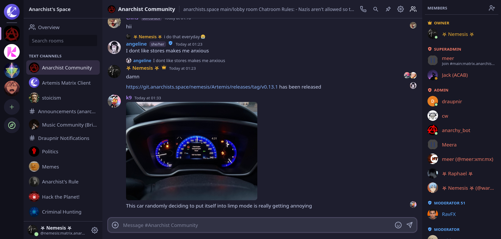
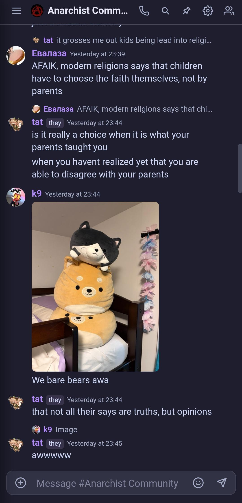

# Artemis

A [Matrix](https://matrix.org) client for Linux, Windows, and Android with a Discord-style layout. Built with Rust, matrix-sdk, and [Tauri 2](https://tauri.app).

| Desktop | Android |
| --- | --- |
|  |  |

## Features

- **Sign up and sign in** · Log in with a Matrix password, or create an account on any homeserver that allows sign-ups. Artemis follows the Matrix registration API and handles registration tokens, terms of service, and email verification in the app; other checks such as CAPTCHAs open the homeserver's own page in your browser. Homeservers that only allow sign-up on their own website can't create accounts here.
- **Chat and media** · Encrypted rooms and DMs, key recovery, Markdown, @mentions, replies, edits, reactions, attachments, emoji, custom emoji and stickers, and GIFs. Create your own emoji pack in **Settings → Emoji**, or a room pack in **Room settings → Emoji**. **Import pack** turns a Discord, emoji.gg, or stickers.gg download (a .zip or loose PNG, APNG, GIF, WebP, or JPEG files) into a pack, keeping animation. Stickers can be up to 8 MB each and emoji up to 1 MB; Lottie stickers are skipped. Tap a read-receipt avatar to see who read a message.
- **Voice calls** · Join a voice call in any room or call someone from a DM with the phone button in the room header. DM calls ring the other person. Calls use MatrixRTC with a LiveKit media server in the same format as Element Call and Element X, and are end-to-end encrypted in encrypted rooms. Your homeserver must offer a MatrixRTC (LiveKit) service. On Linux the desktop app plays and records call audio natively through PulseAudio or PipeWire, because WebKitGTK usually ships without WebRTC.
- **Home** · Online DM contacts when the homeserver provides presence, searchable DMs, and collapsible sections that remember their state across restarts.
- **Profiles** · Change your display name, profile picture, bio, banner, and pronouns in **Settings → Profile**. Pronouns appear beside chat usernames. Extended profile fields depend on homeserver support.
- **Message links and forwarding** · Copy a link to any message, paste `matrix:` or matrix.to links to show them as room and message chips with a preview, and forward messages or attachments to other rooms and DMs.
- **Discovery** · Browse and search public rooms on your homeserver or any other server with the compass button in the left rail. Spaces list every room you can join, including ones you haven't joined yet, and you can ask to join rooms that need approval.
- **Mentions** · The **Mentions** tab of the Home inbox (Ctrl+I) lists unread messages that mention you across all rooms, with a Jump button for each. Inside a room, a “new mentions” pill takes you through unread mentions one by one. Type @everyone to notify the whole room when your role allows it; it is sent as a standard Matrix @room mention.
- **Rooms and moderation** · Invite users to rooms and spaces by Matrix ID from the Members panel. Change room details, who can join, history visibility, guest access, directory listing, addresses, and per-action permissions in Room settings. Manage member power levels, kick, ban or unban users, and leave rooms. Matrix permissions apply. Role icons appear in member-group headings and beside chat usernames.
- **Status** · Click your name in the bottom-left to appear Online, Away, or offline and set a status message. While you appear offline, Artemis doesn't send typing indicators and keeps your read receipts private. Other people’s status messages show in the member list and on their profiles, along with when they were last active.
- **Privacy** · Block users from their profiles or **Settings → Privacy**. The Matrix block list syncs across devices. Choose who can invite you (everyone, people you share a room with, only your contacts, or nobody), always allow specific people, and block whole servers. Filtered invites are declined automatically or hidden for review. Invite settings sync across devices.
- **App lock** · Protect everything Artemis stores on your device with a password in **Settings → App lock** on desktop and Android. Artemis asks for it at startup, and the lock button beside Settings locks it again. Messages, encryption keys, your sign-in, cached media, and drafts are all encrypted with it. If you forget the password, you can erase local data and sign in again.
- **Sessions** · See every device signed in to your account, whether it's verified, and sign out specific sessions in **Settings → Sessions**.
- **Settings** · Light and dark themes, Android notification previews, and Developer Tools with session diagnostics and an access-token reveal control.

## Build from source

Install Rust 1.96 or newer, Node.js LTS, npm, and the [Tauri prerequisites](https://v2.tauri.app/start/prerequisites/) for your platform.

```bash
git clone https://git.anarchists.space/nemesis/Artemis.git
cd Artemis
npm install
```

The frontend source is in `frontend/`. Tauri runs `npm run ui:build` before development and packaging. This compiles TypeScript into `ui/js/` and prepares the pinned Markdown dependencies and Twemoji assets in `ui/vendor/`. Run `npm run ui:watch` in a separate terminal to recompile when editing TypeScript.

### Web

Run `npm run web:build` to build the browser client into `web-dist/`. See [Deploy Artemis Web](DEPLOY.md) for hosting requirements. See [Nginx setup](deploy/NGINX.md) for a server-specific example.

### Desktop

```bash
npm run dev
npm run build
```

Native installers go in `src-tauri/target/release/bundle/`. Build on Windows to produce an MSI.

On Linux, the first build downloads a prebuilt WebRTC library (about 150 MB) from LiveKit's GitHub releases for call audio. For offline builds such as Flatpak, download `webrtc-linux-<x64|arm64>-release.zip` from the `webrtc-51ef663` release of `livekit/rust-sdks`, extract it, and set `LK_CUSTOM_WEBRTC` to the extracted `linux-<x64|arm64>-release` folder.

To cross-build an x64 Windows NSIS installer on Fedora 44, run these commands after the setup above. [Tauri cross-build guide](https://v2.tauri.app/distribute/windows-installer/)

```bash
sudo dnf install clang llvm lld gcc mingw32-nsis mingw64-nsis
rustup target add x86_64-pc-windows-msvc
cargo install --locked cargo-xwin
npx tauri build --runner cargo-xwin --target x86_64-pc-windows-msvc --bundles nsis
```

The Windows `*-setup.exe` goes in `src-tauri/target/x86_64-pc-windows-msvc/release/bundle/nsis/`.

### Android

Install JDK 17 and the Android SDK and NDK, set `JAVA_HOME`, `ANDROID_HOME`, and `NDK_HOME`, and add the ARM64 Rust target. For a release-signed APK, copy `keystore.properties.example` to `keystore.properties` and enter your signing details. [Android prerequisites](https://v2.tauri.app/start/prerequisites/#android) · [Android signing](https://v2.tauri.app/distribute/sign/android/)

```bash
rustup target add aarch64-linux-android
npm run android:init
npm run android:build
```

Run `android:init` once per checkout. Use `npm run android:dev` for development on a connected device. To verify local notifications, enable them in **Settings → Account** and tap **Send test notification**. Message previews follow Matrix notification rules and arrive while Artemis is running and syncing.

In **Settings → Account → Android notifications**, enable incoming voice call alerts and grant Android notification permission. When Artemis is minimized, a DM call appears in the incoming calls channel with **Answer** and **Decline**. Grant microphone access the first time you join a call. An ongoing call notification returns you to the call while you use other apps. Background alerts use the running Matrix sync session, so open Artemis again after removing its task or force-stopping it.

### Optional build settings

- **GIF API key** · Copy `gif.env.example` to `gif.env` and set `ARTEMIS_GIF_PROVIDER` and `ARTEMIS_GIF_API_KEY`. Use a key you can share publicly in distributed builds. A key entered in **Settings → GIFs** takes priority.
- **Icons** · Run `npm run icons` after updating `assets/logo.png`.

## Security and testing

Sign in with a Matrix password, or create an account with **Register** on the login screen. Artemis supports HTTPS homeservers and loopback HTTP for local testing. Markdown is sanitized before display, and external links that use plain HTTP or hide their destination ask for confirmation before opening. The web build keeps your access token in browser storage, like other Matrix web clients. Keep your recovery key and access token private. Set up recovery before logging out if you need to recover encrypted history on a new session. See [SECURITY.md](SECURITY.md) for the full security policy and known tradeoffs.

```bash
npm run ui:build
cargo test --manifest-path src-tauri/Cargo.toml
```

Report issues or submit patches at the [Artemis repository](https://git.anarchists.space/nemesis/Artemis).

## License

Copyright © 2026 Nemesis. Licensed under the [GNU Affero General Public License v3.0 or later](LICENSE).

The call icons (phone, microphone, headphones and speaker) come from [Lucide](https://lucide.dev) under the [ISC License](docs/third-party/lucide-LICENSE).
